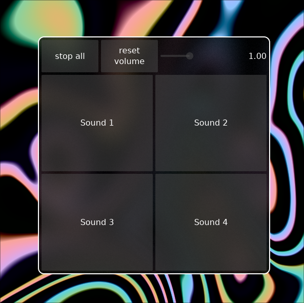

# Gridboard, a simple sounboard app



## Usage

### Main program

```
gridboard [path/to/config.jsonc] [-h | --help] [-v | --version]
```

If no config path is provided, the app will get it's config from `$XDG_CONFIG_HOME/gridboard/config.jsonc` on Linux, `%APPDATA%\gridboard\config\config.jsonc` on Windows, or `~/Library/Application Support/gridboard/config.jsonc` on MacOS.

### Remote interaction

```
gridboardctl <command>
```

Commands:

- `play <path>`: Play a sound at <path>.
- `stop`: Stop the playback of all currently playing sounds.
- `volume`: Get the current volume (1.0 is full volume).
- `volume <volume>`: Set the current volume (1.0 is full volume).

## [Example config](assets/example-config.jsonc)

```jsonc
{
  "channels": 2, // The amount of channels to open the audio stream with.
  "sample_rate": 48000, // The sample rate to open the audio stream with.
  "buffer_size": 4096, // The buffer size of the audio stream. The audio will start tearing if set too low.
  "gui": {
    // Can be set to null to make the engine run without a GUI.
    "window_width": 500, // The initial width of the window.
    "window_height": 500, // The initial height of the window.
    "grid_size": [4, 4], // The grid dimentions the button area has. [width, height]
    "buttons": [
      // The button definitions.
      {
        "name": "Sound 1", // The text to be displayed on the button.
        "sound": "/path/to/sound 1.mp3", // The path to the sound to be played with this button.
        "image": "/path/to/image 1.png", // The path to the image to be displayed on this button. Can be null or omitted to display a button without an image.
        "position": [0, 0], // The position [of the button in grid units, starting from the top left of the button area. [right, down]
        "size": [1, 1], // The size of the button in grid units. [width, height]
      },
      {
        "name": "Sound 2",
        "sound": "/path/to/sound 2.wav",
        "image": "/path/to/image 2.jpg",
        "position": [2, 0],
        "size": [2, 2],
      },
      {
        "name": "Sound 3",
        "sound": "/path/to/sound 3.flac",
        "position": [0, 2],
        "size": [4, 1],
      },
      {
        "name": "Sound 4",
        "sound": "/path/to/sound 4.ogg",
        "position": [1, 3],
        "size": [2, 1],
      },
    ],
  },
}
```
